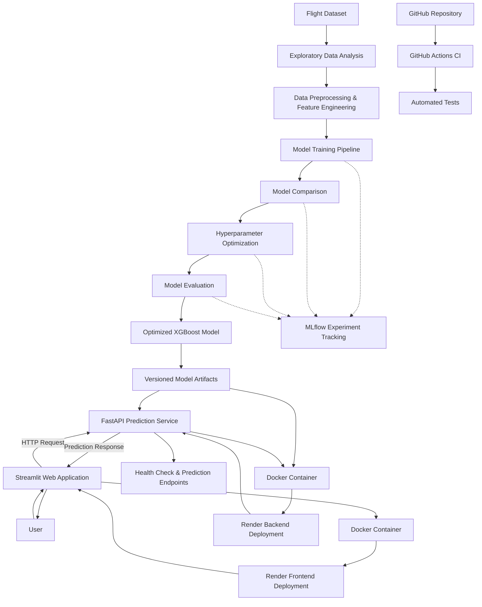

# ✈️ Flight Price Prediction – End-to-End MLOps Project

An end-to-end Machine Learning and MLOps application that predicts flight ticket prices using an optimized XGBoost regression model. The project demonstrates the complete ML lifecycle, from exploratory data analysis and model development to experiment tracking, API development, containerization, CI automation, and cloud deployment.

🌐 **Live Application:** [Flight Price Prediction](https://flight-price-frontend-aatt.onrender.com/)

⚙️ **Backend API:** [Flight Prediction API](https://flight-price-api-f1mv.onrender.com/)

📖 **API Documentation:** [Swagger UI](https://flight-price-api-f1mv.onrender.com/docs)

---

## 📌 Project Overview

Flight ticket prices vary depending on several factors, including airline, route, departure time, arrival time, travel duration, number of stops, travel class, and days remaining before departure.

This project develops a machine learning solution to estimate flight ticket prices based on relevant flight information.

Beyond model development, the primary objective is to implement an end-to-end MLOps workflow using modern engineering practices and deploy the application as a cloud-hosted service.

### Key Highlights

- Exploratory Data Analysis and feature engineering.
- Multiple machine learning model experiments and comparisons.
- Hyperparameter optimization using Optuna and GridSearchCV.
- Optimized XGBoost regression model.
- Experiment tracking using MLflow.
- Model packaging and versioned artifacts.
- REST API development using FastAPI.
- Interactive web application using Streamlit.
- Containerization using Docker and Docker Compose.
- Automated testing and CI using GitHub Actions.
- Cloud deployment using Render.

---

## 🏗️ System Architecture

The application follows a modular architecture that separates model development, experiment tracking, model serving, and user interaction.



### Architecture Components

| Component | Technology | Purpose |
|---|---|---|
| Data Analysis | Python, Pandas, Matplotlib, Seaborn | Data exploration and analysis |
| Model Development | Scikit-learn, XGBoost | Model training and evaluation |
| Hyperparameter Tuning | Optuna, GridSearchCV | Model optimization |
| Experiment Tracking | MLflow | Tracking model experiments |
| Model Packaging | Joblib, JSON | Model serialization and configuration |
| Backend | FastAPI, Uvicorn | Prediction REST API |
| Frontend | Streamlit | Interactive prediction interface |
| Containerization | Docker, Docker Compose | Application packaging and orchestration |
| CI Automation | GitHub Actions | Automated testing |
| Cloud Hosting | Render | Application deployment |

---

## 🧠 Machine Learning Workflow

The machine learning workflow follows a structured development and evaluation process.

### 1. Exploratory Data Analysis

- Examined dataset structure and data types.
- Analyzed missing values and data distributions.
- Investigated relationships between flight attributes and ticket prices.
- Identified relevant patterns and feature relationships.

### 2. Data Preprocessing

- Handled categorical and numerical features.
- Prepared model-ready input data.
- Applied consistent preprocessing to training and prediction inputs.
- Maintained feature schema and numerical range configurations.

### 3. Model Development

Multiple regression algorithms were evaluated to identify a suitable model for flight price prediction.

### 4. Hyperparameter Optimization

- Optuna for automated hyperparameter optimization.
- GridSearchCV for systematic parameter evaluation.
- Compared model performance to select the final configuration.

### 5. Model Evaluation

The final model was evaluated using regression performance metrics, including:

- Mean Absolute Error (MAE)
- Mean Squared Error (MSE)
- Root Mean Squared Error (RMSE)
- R² Score

### 6. Model Packaging

The selected model and supporting configurations are stored as versioned artifacts.

**Final selected model:** Optimized XGBoost Regression  
**Artifact version:** `1.0`  
**Expected input features:** 12

---

## 🔬 Experiment Tracking with MLflow

MLflow is integrated into the model development workflow to track machine learning experiments.

The tracking workflow supports:

- Recording model parameters.
- Tracking evaluation metrics.
- Comparing model experiments.
- Maintaining experiment history.

This provides better visibility into model development and makes experimentation more organized and reproducible.

---

## ⚙️ Backend – FastAPI

The prediction backend is developed using FastAPI.

It loads the packaged XGBoost model and processes incoming prediction requests using the expected feature schema.

### API Endpoints

| Method | Endpoint | Description |
|---|---|---|
| GET | `/health` | Checks API and model availability |
| POST | `/predict` | Generates flight price predictions |
| GET | `/docs` | Interactive Swagger API documentation |

**Live API:** https://flight-price-api-f1mv.onrender.com

**Swagger Documentation:** https://flight-price-api-f1mv.onrender.com/docs

---

## 🖥️ Frontend – Streamlit

The frontend is developed using Streamlit to provide an interactive interface for flight price prediction.

Users can enter relevant flight details and submit them to the FastAPI backend.

The frontend communicates with the backend through HTTP requests and displays the prediction returned by the model.

**Live Application:** https://flight-price-frontend-aatt.onrender.com/

---

## 🐳 Docker & Containerization

Both the frontend and backend are containerized independently.

### Docker Components

- `Dockerfile.api` – Builds the FastAPI backend image.
- `Dockerfile.frontend` – Builds the Streamlit frontend image.
- `docker-compose.yml` – Coordinates both services locally.

Docker Compose manages the application services and their communication.

### Run Locally Using Docker Compose

```bash
git clone https://github.com/BrutalBeast25/flight-price-prediction-mlops.git

cd flight-price-prediction-mlops

docker compose up --build -d
```

Access the services:

- Frontend: http://localhost:8501
- Backend: http://localhost:8000
- API Documentation: http://localhost:8000/docs

To stop the application:

```bash
docker compose down
```

---

## 🔄 Continuous Integration – GitHub Actions

GitHub Actions is integrated into the repository to automate code validation and testing.

The CI workflow executes automated tests whenever changes are pushed to the configured branch or a pull request is created.

The workflow helps validate application components and identify integration issues before changes are merged.

**Workflow configuration:** `.github/workflows/ci.yml`

---

## ☁️ Cloud Deployment – Render

The application is deployed using Render with separate frontend and backend services.

| Service | Deployment |
|---|---|
| Frontend | Render Web Service |
| Backend | Render Web Service |
| Backend communication | Public HTTPS API URL |
| Application packaging | Docker |

The frontend communicates with the deployed backend through the `API_URL` environment variable.

This deployment approach keeps the application modular and separates user interaction from model inference.

### Live Deployment

🚀 **Frontend:** https://flight-price-frontend-aatt.onrender.com/

⚙️ **Backend:** https://flight-price-api-f1mv.onrender.com/

---

## 📂 Repository Structure

```text
flight-price-prediction-mlops/
│
├── .github/
│   └── workflows/
│       └── ci.yml
│
├── artifacts/
│   └── v1.0/
│       ├── environment.json
│       ├── evaluation_metrics.json
│       ├── feature_schema.json
│       ├── model.joblib
│       ├── model_config.json
│       ├── numeric_ranges.json
│       ├── sample_input.json
│       └── ui_options.json
│
├── data/
│   ├── processed/
│   └── raw/
│
├── docs/
│   └── eda_findings.md
│
├── frontend/
│   └── streamlit_app.py
│
├── models/
│
├── notebooks/
│   └── 01_exploratory_data_analysis.ipynb
│
├── src/
│   ├── api.py
│   └── ... 
│
├── tests/
│   ├── test_api.py
│   └── test_preprocessing.py
│
├── .dockerignore
├── .gitignore
├── docker-compose.yml
├── Dockerfile.api
├── Dockerfile.frontend
├── requirements.txt
├── requirements-api.txt
├── requirements-frontend.txt
├── README.md
└── LICENSE
```

---

## 🛠️ Technology Stack

**Programming Language**
- Python 3.11

**Data Science & Machine Learning**
- NumPy
- Pandas
- Scikit-learn
- XGBoost
- Optuna

**Experiment Tracking**
- MLflow

**Backend & Frontend**
- FastAPI
- Uvicorn
- Streamlit

**Engineering & Deployment**
- Docker
- Docker Compose
- GitHub Actions
- Render
- Git

---

## 📸 Application Screenshots

The following section showcases the deployed flight price prediction application.

<!-- Add your screenshot to docs/images/ and update the image path below. -->


---

## 🚀 Future Improvements

Potential enhancements for future iterations include:

- MLflow Model Registry integration.
- Automated model retraining pipelines.
- Data drift and model performance monitoring.
- Advanced CI/CD deployment workflows.
- Cloud-based model monitoring and observability.

---

## 🎯 Project Objective

This project demonstrates the practical implementation of an end-to-end Machine Learning application, combining data science, model development, software engineering, API development, containerization, automation, and cloud deployment.

The emphasis is on building a modular, reproducible, and cost-conscious MLOps solution using industry-relevant technologies.

---

## 👨‍💻 Author

**Manivannan**

M.Sc. Data Science with Business Analytics

Interested in Machine Learning Engineering, Data Engineering, AI, and MLOps.

- GitHub: [@BrutalBeast25](https://github.com/BrutalBeast25)
- Portfolio: [Visit Portfolio](https://github.com/BrutalBeast25)

---

⭐ If you find this project interesting, feel free to explore the repository and try the live application!
